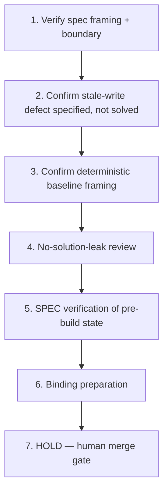

# Implementation Plan: Optimistic-Concurrency API Repair

## Overview

This plan is a Kiro spec review/preparation pass in local session sess_ef9c3844-0570-409c-baa6-7cc73d898476 for issue #208, an AUTOGENERATED BOOTCAMP CANDIDATE. No starter commit exists yet: the synthetic starter is PROSPECTIVE and MAY be prepared by downstream automation only after this spec passes a real Kiro review and Ky merges the specs-only PR. Tasks below are read-only review/verification and binding-preparation steps; none of them build, implement, or seed the starter, identify the conflict boundary, or add decisive stale-version assertions. Each implementation task has a coder and a different reviewer and traces to requirement IDs. Governing invariant INV-1 is preserved. No human authorship is claimed.

## Tasks

1. **Verify spec framing: verbatim Goal, row identity, and prospective-starter boundary** (R1, R2, R10)
   - Assigned coder: **Codex**
   - Reviewer: **Cursor**
   - Confirm (read-only) that `requirements.md` carries the exact Goal as a standalone paragraph, the literal `Task Factory row` line, the Notion row, `ODIN_BOOTCAMP_SPEC_ROW_ID:3f58621e-0a7a-8184-9346-f9267a82618f`, the empty Approval ID, and the issue starter-contract boundary (self-contained local Python/TS package; no network/credentials/private code/third-party service; stop before the conflict boundary, implementation change, decisive assertions, or solution diff). Confirm the production-isolation/distributed-behavior limit is recorded. Do NOT prepare or seed any starter.

2. **Confirm the diagnostic-level stale-write defect is specified, not solved** (R3, R5; INV-1)
   - Assigned coder: **Codex**
   - Reviewer: **Cursor**
   - Confirm the spec describes, at the diagnostic level only, that the update function applies the client representation without enforcing the version precondition so a stale write can overwrite a newer version. Confirm the spec does NOT identify the correct conflict boundary, does NOT state decisive stale-version assertions, and does NOT hint the fix.

3. **Confirm deterministic-baseline and ordinary-path framing (pins/commands UNKNOWN)** (R4, R6, R7)
   - Assigned coder: **Codex**
   - Reviewer: **Cursor**
   - Confirm the spec requires a deterministic, network-free, repeatable local baseline that exits 0 and preserves the ordinary current-version update, and that the exact command, output substring/test count, and source pin are marked UNKNOWN (to be captured from real CLI output and bound downstream) and are NOT invented. Confirm existing baseline checks are required to stay meaningful.

4. **Perform no-solution-leak review** (R8, R9)
   - Assigned coder: **Cursor**
   - Reviewer: **Codex**
   - Confirm the spec mandates recorder-visible files free of completed version-precondition enforcement, decisive stale-version/state-preservation tests, an identified conflict boundary, a diagnosis note, or a solution diff, and that pre-recording integrity (ordinary pass, gap present, human work undone) is verifiable read-only.

5. **Technical SPEC verification only: candidate framing is bounded and no starter is implied built** (R5, R9)
   - Assigned coder: **Codex**
   - Reviewer: **Cursor**
   - Confirm (read-only) the candidate remains in a pre-build, spec-only state: the starter is prospective, the human-execution work (version-precondition repair + decisive verification + teach-back) is still undone, and nothing here builds or pins it. This is technical SPEC verification only; human capture admission is SEPARATELY PENDING. A spec PASS implies NO Odin paid approval, NO completed capture/pre-record gate checks, and NO unaided mastery.

6. **Binding preparation (no duplication; precondition-gated)** (provenance; Introduction Source/Goal bindings; R2, R4)
   - Assigned coder: **Cursor**
   - Reviewer: **Codex**
   - FUTURE downstream registration/scripts MUST bind the exact row id (`ODIN_BOOTCAMP_SPEC_ROW_ID:3f58621e-0a7a-8184-9346-f9267a82618f`), the Notion row `3f58621e0a7a81849346f9267a82618f`, the verbatim Goal, these requirements, INV-1, and — once computed/captured from real artifacts — the Goal+LF SHA256, the eventual source pin, and the verified baseline command/output substring. Reuse the existing prep registry/helper/publisher/learning-map/paired GHA artifacts and the existing Notion row; never duplicate trackers or jobs. An actual Kiro review PASS plus Ky's merge of the specs-only PR to `main` is a PRECONDITION for any starter preparation and for any binding/script/registration implementation; such implementation is NOT an executable step of this plan. Do NOT invent a commit SHA or Goal hash.

7. **HOLD — human merge gate (final)**
   - All starter preparation, coding, and source promotion are HELD until Ky merges the eventual specs-only PR with green required checks (repo CI + `ai-governance / verdict`). Receipt gate: after an actual completed Kiro review the authenticated publisher captures real CLI output and publishes one private `cloud/kiro-receipts/<actual-id>.json` and paired `.capture.txt` at a full immutable commit binding the execution target, row/Goal/path/PR, and every spec document hash; it adds `KIRO_RECEIPT_COMMIT:<actual40>` and `KIRO_RECEIPT_SHA256:<actual64>` to the PR body. Missing captured evidence, spec PASS, private receipt, or human merge remains HOLD; never manufacture a PASS receipt. Agents never merge, approve, deploy, or promote source. Human diagnosis, repair, recording, attempt, approval, and pay remain human-owned and are not implied by this spec.

## Task Dependency Graph



```json
{
  "waves": [
    ["1"],
    ["2"],
    ["3"],
    ["4"],
    ["5"],
    ["6"],
    ["7"]
  ]
}
```

## Notes

- No starter exists yet; every task is read-only review/binding-preparation. Nothing here builds, seeds, pins, or implements the starter, identifies the conflict boundary, or adds decisive stale-version assertions.
- Coder/reviewer are always distinct: Codex codes and Cursor reviews on verification tasks; Cursor codes and Codex reviews on review and binding-preparation tasks.
- SPEC PASS at this stage is technical only; it does not establish Odin paid approval, completed capture, or human mastery. The current intended mode is guided recording/practice; a separate future unaided Transfer Test is a distinct assessment, not part of this spec or guided world prep.
- Source pin and Goal+LF SHA256 are UNKNOWN and MUST NOT be invented; they are computed/captured from real artifacts downstream after this spec passes and Ky merges.
