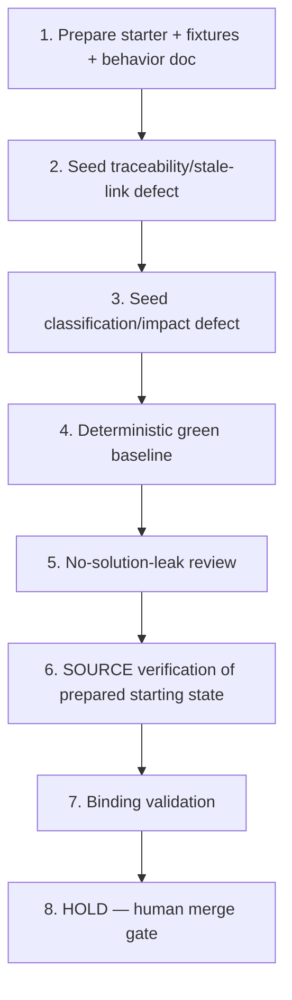

# Implementation Plan: Requirements Change-Control Traceability Repair

## Overview

This plan is a Kiro spec review/enhancement in local session sess_82309770-7349-46bb-ab4b-ae3a937b8c7f. The synthetic starter does **not yet exist**: there is no pinned commit, no Goal+LF SHA256, and no source URL yet. Construction verbs below are therefore framed as DOWNSTREAM PREPARATION that occurs only after @KyPython merges this specs-only PR; they are NOT already satisfied and NO pin is bound here. Each task has a coder and a different reviewer (drawn from the coder identities in `roles.yml`) and traces to requirement IDs. Governing invariant INV-1 is preserved. No prior authorship is claimed, and nothing is executed in this session.

## Tasks

1. **Downstream preparation (after merge): synthetic starter, fixtures, and intended-behavior doc** (R1, R2)
   - Assigned coder: **Codex**
   - Reviewer: **Cursor**
   - After merge, prepare the fabricated requirements baseline, the one approved change request, acceptance criteria, the traceability matrix, deterministic fixtures, ordinary checks, the repeatable validation command, and a neutral intended-behavior description. Then bind the source pin (full commit SHA) and record it; no pin is invented here. Preparation MUST stop before choosing the correct requirement classification, deciding the impact set, repairing artifacts, adding decisive negative checks, or including a solution diff.

2. **Downstream preparation (after merge): seed and confirm the traceability/stale-link defect** (R3, R6; INV-1)
   - Assigned coder: **Codex**
   - Reviewer: **Cursor**
   - Seed and confirm that the updated requirement, acceptance criteria, and verification links are mutually inconsistent (a stale/obsolete acceptance path, duplicate identifier, or misclassification remains). Describe only at the diagnostic level; do not write or hint the fix.

3. **Downstream preparation (after merge): seed and confirm the classification/impact defect** (R4, R6; INV-1)
   - Assigned coder: **Cursor**
   - Reviewer: **Codex**
   - Seed and confirm that the requirement classification or impact set is inconsistent with the approved change (an affected work product or acceptance link is misclassified or missing). Describe only at the diagnostic level; do not write or hint the fix.

4. **Downstream preparation (after merge): deterministic green baseline locally** (R5, R7, R8)
   - Assigned coder: **Codex**
   - Reviewer: **Cursor**
   - Prepare and confirm the repeatable validation command exits 0 with the bound exit code and output substring, that repeated runs produce byte-identical serialized reports, and that existing checks remain meaningful. Bind the baseline exit code and output substring at preparation time; do not alter the baseline to pass.

5. **No-solution-leak review** (R9, R10)
   - Assigned coder: **Cursor**
   - Reviewer: **Codex**
   - Confirm there is no chosen requirement classification, decided impact set, repaired links/artifacts, decisive negative checks, completed deterministic traceability report, diagnosis note, or expected patch diff in recorder-visible files.

6. **Technical SOURCE verification only: prepared starter is in the defective starting state** (R6, R10)
   - Assigned coder: **Codex**
   - Reviewer: **Cursor**
   - After the starter is prepared and pinned, confirm (read-only) it is in the defective, baseline-green starting state with the human-execution work (classification decision + impact set + link/artifact repair + decisive negative checks + deterministic traceability report) still undone. This is technical SOURCE verification only against the bound pin; human capture admission is SEPARATELY PENDING. A spec/source PASS implies NO Odin paid approval, NO completed capture/pre-record gate checks, and NO unaided mastery.

7. **Binding validation (no duplication)** (provenance; INV-1)
   - Assigned coder: **Cursor**
   - Reviewer: **Codex**
   - After the pin exists, downstream registration/scripts MUST bind the exact Source SHA (bound in task 1, UNKNOWN until then), the verbatim Goal, these requirements, INV-1, and the baseline output substring (bound in task 4). Reuse the existing prep registry/helper/publisher/learning-map/paired GHA artifacts and the existing Notion row (`3f68621e0a7a815da0b3d1f6ea87533e`). Never duplicate trackers or jobs, and never invent a SHA, hash, or PR number.

8. **HOLD — human merge gate (final)**
   - All coding and source promotion are HELD until Ky merges this specs-only PR with green required checks (repo CI + `ai-governance / verdict`). Agents never merge, approve, deploy, or promote source. Human diagnosis, repair, recording, attempt, approval, and pay remain human-owned and are not implied by this spec. The Candidate-stage empty Approved Goal / Approval ID / approval / pay / attempt fields are preserved unchanged.

## Task Dependency Graph



```json
{
  "waves": [
    ["1"],
    ["2"],
    ["3"],
    ["4"],
    ["5"],
    ["6"],
    ["7"],
    ["8"]
  ]
}
```

## Notes

- Construction verbs in tasks 1–4 are DOWNSTREAM PREPARATION that occurs only after merge; no pin exists yet, so they are NOT already satisfied and bind no SHA/hash here.
- Coder/reviewer are always distinct: Codex and Cursor alternate the coder/reviewer roles across tasks; coder ≠ reviewer on every task.
- SOURCE PASS at the later stage is technical only; it does not establish Odin paid approval, completed capture, or human mastery. The current intended mode is guided recording/practice; a separate future unaided Transfer Test is a distinct assessment, not part of this spec or guided world prep.
- No SHA, Goal+LF SHA256, source URL, PR number, PASS, or receipt is invented in this spec; the source pin and baseline substring are bound only during downstream preparation after merge.
