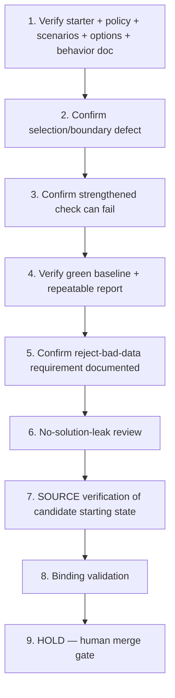

# Implementation Plan: Resilient Architecture Decision Matrix Repair

## Overview

This plan is a Kiro spec-authoring pass for the Odin bootcamp item "Resilient Architecture Decision Matrix Repair." Downstream automation will prepare and pin the synthetic starter; construction verbs below are verification-only against that eventual pin and MUST NOT rebuild or reseed it. Each task has a coder and a different reviewer (Codex and Cursor, alternated so coder != reviewer) and traces to requirement IDs. Governing invariant INV-1 is preserved. No prior authorship is claimed, and no solution content (correct option, decision-rule fix, decisive scenarios, diagnosis, or patch) is produced.

## Tasks

1. **Verify: synthetic starter, recovery policy, scenarios, options, and intended-behavior doc** (R1, R2)
   - Assigned coder: **Codex**
   - Reviewer: **Cursor**
   - Confirm (read-only) that the pinned commit holds synthetic evaluator code, the written recovery policy, deterministic workload/failure scenarios, three abstract architecture options, and a neutral intended-behavior description. Do NOT rebuild, reseed, or name a correct option; the pin is authoritative.

2. **Confirm the diagnostic-level selection/boundary defect is present under changed constraints** (R3, R6; INV-1)
   - Assigned coder: **Codex**
   - Reviewer: **Cursor**
   - Confirm that under the changed workload constraints the evaluator selects an unsuitable disaster-recovery design due to a seeded selection or boundary defect. Describe only at the diagnostic level; do not write or hint the fix.

3. **Confirm a strengthened changed-scenario / recovery-boundary check can fail the defective evaluator** (R4, R6; INV-1)
   - Assigned coder: **Codex**
   - Reviewer: **Cursor**
   - Confirm that at least one strengthened changed-scenario or recovery-boundary check would fail against the defective evaluator. Describe the failure boundary only; do not add the decisive scenarios to the recorder-visible starter and do not state the fix.

4. **Verify: deterministic, offline green baseline and repeatable report locally** (R5, R7, R8)
   - Assigned coder: **Codex**
   - Reviewer: **Cursor**
   - Confirm the documented report/baseline command exits 0 with no network/cloud/provider interaction, emits identical serialized reports across repeated runs, and that existing checks remain meaningful.

5. **Confirm the reject-incomplete/contradictory-data requirement is documented, not solved** (R11, R2)
   - Assigned coder: **Codex**
   - Reviewer: **Cursor**
   - Confirm the recorder-visible behavior contract states that the repaired evaluator must reject incomplete or contradictory scenario data rather than silently selecting an unsafe option, without stating how the repair implements it.

6. **Perform no-solution-leak review** (R9, R10)
   - Assigned coder: **Cursor**
   - Reviewer: **Codex**
   - Confirm there is no correct architecture selection, corrected decision rule, decisive changed scenarios, final report answer, diagnosis note, or expected patch diff in recorder-visible files.

7. **Technical SOURCE verification only: candidate starter is in the defective starting state** (R6, R10)
   - Assigned coder: **Codex**
   - Reviewer: **Cursor**
   - Confirm (read-only) the candidate starter is in the defective, baseline-green starting state with the human-execution work (diagnosis + defensible repair + decisive scenarios + tradeoff rationale) still undone. This is technical SOURCE verification only against the pinned commit; human capture admission is SEPARATELY PENDING. A spec/source PASS implies NO Odin paid approval, NO completed capture/pre-record gate checks, and NO unaided mastery.

8. **Binding validation (no duplication)** (provenance; AC1, AC2)
   - Assigned coder: **Cursor**
   - Reviewer: **Codex**
   - Downstream registration/scripts MUST bind the eventual pinned Source SHA, the verbatim Goal, these requirements, INV-1, and the verified baseline evidence. Reuse the existing prep registry/helper/publisher/learning-map/paired GHA artifacts and the existing Notion row (`3f68621e0a7a81c98b3ed3d2e5695ea7`). Never duplicate trackers or jobs. KIRO_RECEIPT_COMMIT / KIRO_RECEIPT_SHA256 remain HOLD/pending and are never manufactured.

9. **HOLD — human merge gate (final)**
   - All coding and source promotion are HELD until Ky merges the eventual specs-only PR with green required checks (repo CI + `ai-governance / verdict`). Agents never merge, approve, deploy, or promote source. The item stays HOLD until captured evidence + spec PASS + private receipt + human (Ky) merge all exist. Human diagnosis, repair, recording, attempt, approval, and pay remain human-owned and are not implied by this spec.

## Task Dependency Graph



```json
{
  "waves": [
    ["1"],
    ["2"],
    ["3"],
    ["4"],
    ["5"],
    ["6"],
    ["7"],
    ["8"],
    ["9"]
  ]
}
```

## Notes

- Construction verbs in verification tasks (1, 4) are verification-only against the eventual pin; never rebuild or reseed.
- Coder/reviewer are always distinct: Codex codes and Cursor reviews on verification tasks; Cursor codes and Codex reviews on review and binding-validation tasks.
- SOURCE PASS at this stage is technical only; it does not establish Odin paid approval, completed capture, or human mastery. The current intended mode is guided recording/practice; a separate future unaided Transfer Test is a distinct assessment, not part of this spec or guided world prep.
