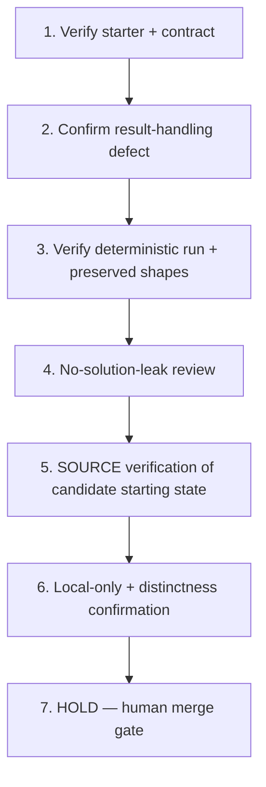

# Implementation Plan: Typed Event-Result Boundary Repair

## Overview

This plan is a Kiro spec authoring pass in local session UNKNOWN (executionTarget local) — no genuine Kiro execution/session identifier was available in this environment, so none is recorded and none is invented. It describes a pinned, self-contained local TypeScript starter whose result-boundary defect is repaired downstream by a recorded human. Construction verbs below are verification-only against the pinned starter and MUST NOT rebuild or reseed it. Each task has a coder and a different reviewer and traces to requirement IDs. Governing invariant INV-1 is preserved. No prior authorship, human approval, pay, mastery, or Odin approval is claimed, and no KIRO_RECEIPT value is produced here.

## Tasks

1. **Verify (verification-only against the pin): self-contained starter and contract** (R1, R2)
   - Assigned coder: **Codex**
   - Reviewer: **Cursor**
   - Confirm (read-only) that the starter is a self-contained local TypeScript package holding a service function, a written success/failure contract, a caller, synthetic fixtures, ordinary tests, and a repeatable type-check/test command, requiring no network, credentials, private code, or external package service. Do NOT rebuild or reseed; the pin is authoritative.

2. **Confirm the diagnostic-level result-handling defect is present** (R3, R4; INV-1)
   - Assigned coder: **Codex**
   - Reviewer: **Cursor**
   - Confirm the caller can treat an error payload as a successful value and that failure, malformed, and unexpected-state results are not exhaustively narrowed. Describe only at the diagnostic level; do not write or hint the fix, do not select a result abstraction, and do not author the decisive assertion.

3. **Verify (verification-only against the pin): deterministic type-check/test and preserved shapes** (R6, R7, R9)
   - Assigned coder: **Codex**
   - Reviewer: **Cursor**
   - Confirm the documented type-check/test command runs deterministically with no network after setup and produces identical results across repeated runs, that the ordinary tests remain meaningful, and that the exact response shapes and status decisions to preserve are documented.

4. **Perform no-solution-leak review** (R5, R8)
   - Assigned coder: **Cursor**
   - Reviewer: **Codex**
   - Confirm there is no completed typed-result abstraction, no final exhaustive-narrowing implementation, no decisive malformed-result assertions, no diagnosis note, and no expected patch diff in recorder-visible files.

5. **Technical SOURCE verification only: candidate starter is in the defective starting state** (R4, R9)
   - Assigned coder: **Codex**
   - Reviewer: **Cursor**
   - Confirm (read-only) the starter is in the defective starting state with the human-execution work (typed success/failure repair + decisive malformed-result verification) still undone. This is technical SOURCE verification only; human capture admission is SEPARATELY PENDING. A spec/source PASS implies NO Odin paid approval, NO completed capture, and NO unaided mastery.

6. **Local-only verification and distinctness confirmation (read-only)** (R10; provenance; Introduction Goal/variation-axis bindings)
   - Assigned coder: **Cursor**
   - Reviewer: **Codex**
   - STRICTLY read-only confirmation that recorder-visible files document local-only verification (no production transport/observability claim) and that the decisive mechanism is typed success/failure representation and caller-side exhaustiveness (discriminated result contract, exhaustive narrowing, runtime validation at the boundary), distinct from Lambda event-shape normalization, OAuth state-binding validation, regex repair, CI contract transfer, and async idempotency. Do NOT re-register, promote source, or author content; do not fabricate a receipt or SHA. Preserve the empty Candidate-stage approval/pay/attempt fields unchanged.

7. **HOLD — human merge gate (final)**
   - All coding and source promotion are HELD until Ky (@KyPython) merges the specs-only PR with green required checks (repo CI + `ai-governance / verdict`). Agents never merge, approve, deploy, or promote source. Human diagnosis, repair, recording, attempt, approval, and pay remain human-owned and are not implied by this spec. No KIRO_RECEIPT_COMMIT / KIRO_RECEIPT_SHA256 is produced or claimed.

## Task Dependency Graph



```json
{
  "waves": [
    ["1"],
    ["2"],
    ["3"],
    ["4"],
    ["5"],
    ["6"],
    ["7"]
  ]
}
```

## Notes

- Construction verbs in verification tasks (1, 3) are verification-only against the existing pin; never rebuild or reseed.
- Coder/reviewer are always distinct: Codex codes and Cursor reviews on construction/verification tasks (1, 2, 3, 5); Cursor codes and Codex reviews on review and binding/confirmation tasks (4, 6). Both identities are drawn from the repo `roles.yml` coder role.
- SOURCE PASS at this stage is technical only; it does not establish Odin paid approval, completed capture, or human mastery. The spec DESCRIBES; it does not solve. No answer key, decisive assertion, or completed deliverable appears in any spec document.
- No execution/session ID was available, so session is recorded as UNKNOWN rather than invented. No KIRO_RECEIPT value is produced here; receipts are a separate downstream publisher concern.
